<!-- profilescape:start -->

<picture>
  <source media="(prefers-color-scheme: dark)" srcset="https://raw.githubusercontent.com/ThisalDilmeth/ThisalDilmeth/profilescape-output/3d-dark.svg" />
  
</picture>

<a href="https://github.com/ThisalDilmeth">
<picture>
  <source media="(prefers-color-scheme: dark)" srcset="https://raw.githubusercontent.com/ThisalDilmeth/ThisalDilmeth/profilescape-output/social-github-dark.svg" />
  
</picture>
</a>
<a href="https://www.linkedin.com/in/thisal-dilmeth/">
<picture>
  <source media="(prefers-color-scheme: dark)" srcset="https://raw.githubusercontent.com/ThisalDilmeth/ThisalDilmeth/profilescape-output/social-linkedin-dark.svg" />
  
</picture>
</a>
<a href="mailto:thisal.fix@gmail.com">
<picture>
  <source media="(prefers-color-scheme: dark)" srcset="https://raw.githubusercontent.com/ThisalDilmeth/ThisalDilmeth/profilescape-output/social-email-dark.svg" />
  
</picture>
</a>

<!-- profilescape:end -->
