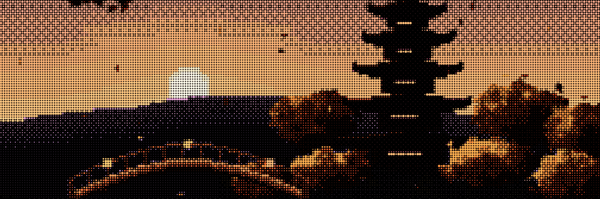

  

  <table width="100%">
    <tr>
      <td width="45%" valign="center">
          

            <tt>
            I'm a Software Engineering undergraduate at Curtin University Colombo and Developer Lead at the Programming Club. I enjoy building useful software, learning how systems work, and turning ideas into projects, from web apps to cloud deployments.
            </tt>
          

          

            <tt>
            I’m currently exploring frontend/backend development and DevOps. Feel free to check out my projects or connect!
            </tt>
          

      </td>
      <td width="10%" valign="center"></td>
      <td width="45%" valign="">
      

        
      

      </td>
    </tr>
  </table>

<!--

**ThisalDilmeth/ThisalDilmeth** is a ✨ _special_ ✨ repository because its `README.md` (this file) appears on your GitHub profile.

Here are some ideas to get you started:

- 🔭 I’m currently working on ...
- 🌱 I’m currently learning ...
- 👯 I’m looking to collaborate on ...
- 🤔 I’m looking for help with ...
- 💬 Ask me about ...
- 📫 How to reach me: ...
- 😄 Pronouns: ...
- ⚡ Fun fact: ...
-->

 

  

<!-- profilescape:start -->

<picture>
  <source media="(prefers-color-scheme: dark)" srcset="https://raw.githubusercontent.com/ThisalDilmeth/ThisalDilmeth/profilescape-output/3d-dark.svg" />
  
</picture>

<a href="https://github.com/ThisalDilmeth">
<picture>
  <source media="(prefers-color-scheme: dark)" srcset="https://raw.githubusercontent.com/ThisalDilmeth/ThisalDilmeth/profilescape-output/social-github-dark.svg" />
  
</picture>
</a>
<a href="https://www.linkedin.com/in/thisal-dilmeth/">
<picture>
  <source media="(prefers-color-scheme: dark)" srcset="https://raw.githubusercontent.com/ThisalDilmeth/ThisalDilmeth/profilescape-output/social-linkedin-dark.svg" />
  
</picture>
</a>
<a href="mailto:thisal.fix@gmail.com">
<picture>
  <source media="(prefers-color-scheme: dark)" srcset="https://raw.githubusercontent.com/ThisalDilmeth/ThisalDilmeth/profilescape-output/social-email-dark.svg" />
  
</picture>
</a>

<!-- profilescape:end -->
